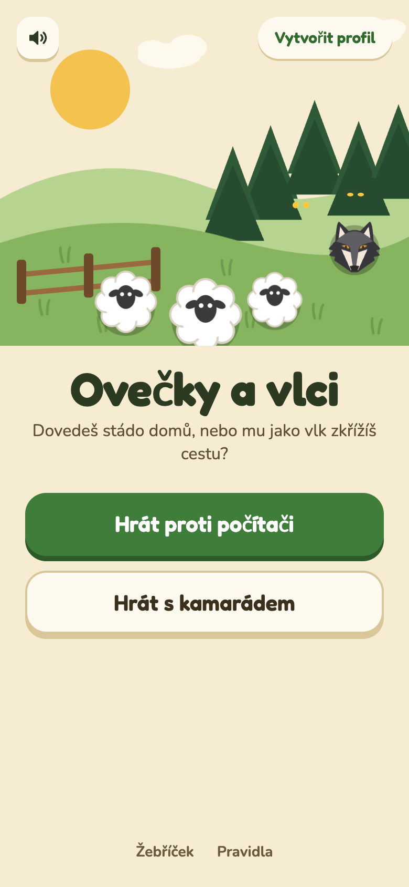
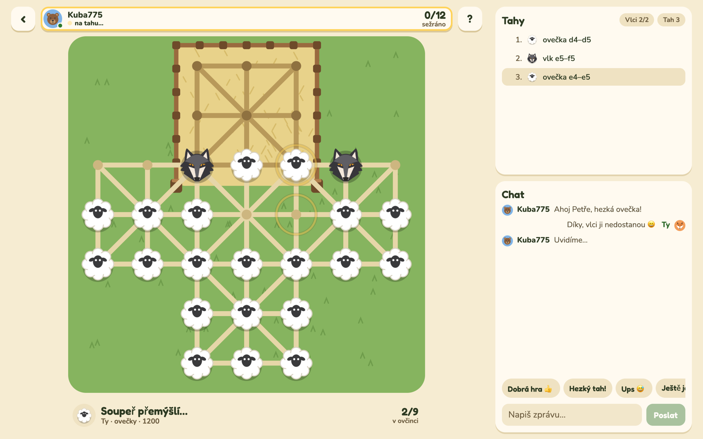
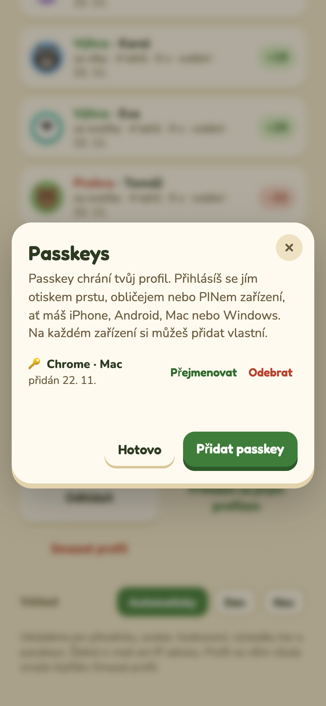

# 🐑 Sheep & Wolves · Ovečky a vlci

A classic two-player board game, rebuilt as an installable web app – play the computer, a friend online, or pass one device around.

**▶️ Play now: [ovecky-a-vlci.petrstastny.workers.dev](https://ovecky-a-vlci.petrstastny.workers.dev) · [English version](https://ovecky-a-vlci.petrstastny.workers.dev/en)**

  
  
  
  

> This repository is a project showcase. The source code is private.

## The game

Twenty sheep against two wolves on a cross-shaped board.

- **The sheep** win by filling the pen – nine points behind the wooden fence. They only move forward or sideways, never back.
- **The wolves** win by catching 12 sheep. They jump over a sheep like in checkers, chain multiple jumps, and must catch when they can – a wolf that misses a catch is removed from the game.
- The sheep may not trap the wolves; their only way to win is to bring the flock home.

It is an old folk game (a relative of Fox and Geese and Halatafl) I played as a kid. I wanted a version that feels good on a phone and has an opponent strong enough to be fun.

## What it can do

### Three ways to play

- **Against the computer** – easy, medium and hard, as sheep, wolves or a random side. The computer runs in a Web Worker, so the game stays smooth and works fully offline.
- **With a friend online** – share a code or link; real-time game over WebSockets with chat, rematch and reconnect.
- **On one device** – pass the phone or tablet around.

### Profiles without registration

- Nickname and animal avatar – no e-mail, no password.
- Secured with **passkeys** (Face ID, Touch ID, Windows Hello, Android), or move to another device with a one-time code / QR.
- Elo rating, leaderboard, game history and stats.
- 8 badges for real achievements – win streaks against the hard computer, a win without losing a single sheep, beating a much higher-rated player…

### Made for the phone

- Installable PWA for iPhone, Android, Mac and Windows, works offline.
- Day and night theme, animations, sound effects and optional background music.
- Czech and English, the board flips for the wolves player, move history with board notation.

  
   
  <em>Desktop layout with move history and chat</em>

  
  
  

## The computer opponent

Three difficulty levels with their own character:

- **Easy** plays almost randomly, but the sheep avoid obvious traps most of the time.
- **Medium** searches three moves ahead.
- **Hard** uses alpha-beta search with iterative deepening; the hard wolf has its own search with a transposition table and extended search through jump sequences.

I tuned the balance with thousands of simulated games between all nine difficulty pairs. The target: in hard-vs-hard play the sheep should win slightly more than half of the games, just like between good human players. The evaluation weights were also tuned automatically by self-play (SPSA).

## How it's built

| Area | Technology |
|---|---|
| Frontend | React 19, TypeScript, Vite, SVG board, PWA (service worker, offline) |
| Backend | Cloudflare Workers, Durable Objects (one per game room, WebSockets), D1 (SQLite) |
| Auth | Passkeys / WebAuthn, HttpOnly session cookies, rate limiting |
| AI | Alpha-beta search in a Web Worker, self-play balancing and tuning |
| Quality | ~200 unit tests (Vitest), 10 end-to-end suites in real Chrome and WebKit (Playwright) |

- Game rules are pure functions shared by the browser and the server – the server validates every online move.
- One Cloudflare Worker serves both the app and the API, on the free tier.
- Privacy by design: no e-mail, no IP addresses stored, deleting a profile deletes everything.

## How I built it

I built the game with an AI coding agent (Claude Code). My job was the product and engineering decisions:

- writing the specification and rules, including edge cases found in simulations,
- breaking the work into detailed prompts and reviewing every result,
- deciding on game balance, UX and privacy trade-offs,
- insisting on tests, simulations and safe production deploys with real players.

It is a practical example of how I work with AI: fast delivery without giving up on quality and control.

## 🇨🇿 Česky

Ovečky a vlci – stará desková hra pro dva, kterou znám z dětství, předělaná do moderní webové aplikace.

- Hra proti počítači (3 obtížnosti), s kamarádem po síti i na jednom zařízení.
- Profil bez registrace zabezpečený passkey, Elo hodnocení, žebříček a 8 odznaků.
- Funguje na iPhonu, Androidu, Macu i Windows a i offline. Česky a anglicky.
- Vyváženost počítače jsem ladil na tisících simulovaných partií.

👉 **Zahrát si: [ovecky-a-vlci.petrstastny.workers.dev](https://ovecky-a-vlci.petrstastny.workers.dev)**

---

Petr Šťastný · AI & Software Developer · LinkedIn
