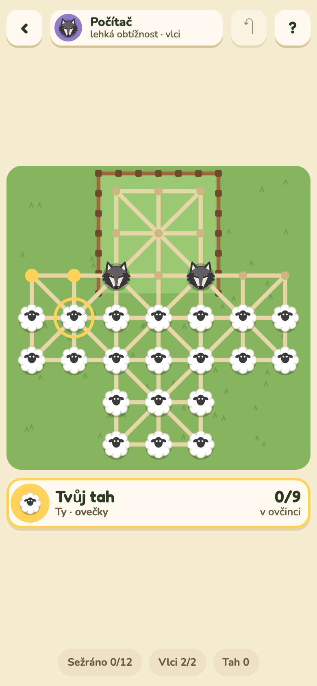
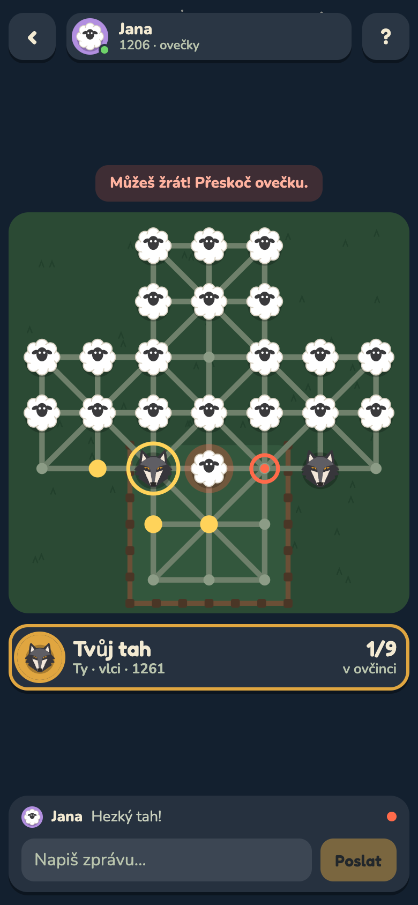
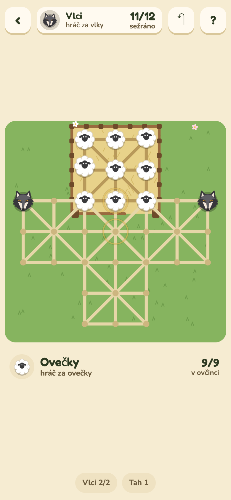
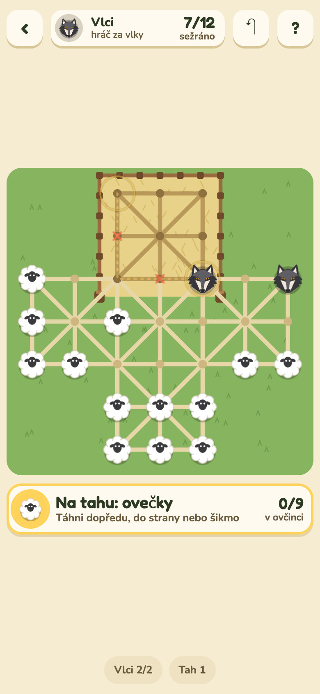
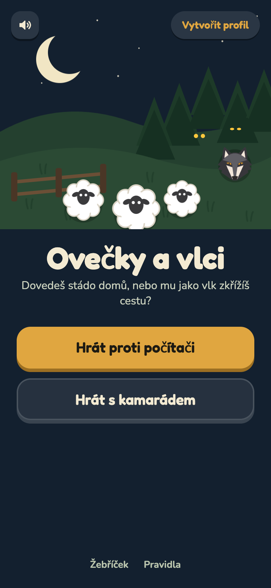

# 🐑 Ovečky a vlci · Sheep & Wolves

**Stará desková hra pro dva jako moderní webová aplikace – hraj proti počítači, s kamarádem po síti, nebo na jednom zařízení.**

▶️ **Zahrát si:** [ovecky-a-vlci.petrstastny.workers.dev](https://ovecky-a-vlci.petrstastny.workers.dev) · [English version](https://ovecky-a-vlci.petrstastny.workers.dev/en)

  
  
  
  

> Tohle repozitář je prezentace projektu. Zdrojový kód je soukromý. *English below.*

---

## O hře

Dvacet oveček proti dvěma vlkům na desce ve tvaru kříže.

- **Ovečky** vyhrají, když zaplní ovčinec – devět bodů za dřevěnou ohradou. Chodí jen dopředu a do stran, nikdy zpátky.
- **Vlci** vyhrají, když sežerou 12 oveček. Skáčou přes ně jako v dámě, i několikrát za sebou, a žrát musí, kdykoli můžou. Vlk, který mohl sežrat a nesežral, ze hry vypadává.
- Ovečky nesmí vlky zablokovat – vyhrát můžou jedině tak, že dovedou stádo domů.

Je to stará lidová hra (příbuzná her *Fox and Geese* a *Halatafl*), kterou znám z dětství. Chtěl jsem verzi, která se dobře hraje na telefonu a má soupeře, se kterým je to zábava.

## Co umí

**Tři způsoby hry**
- **Proti počítači** – lehká, střední a těžká obtížnost, za ovečky, za vlky nebo losem. Počítač přemýšlí na pozadí (Web Worker), takže hra běží plynule a funguje i offline.
- **S kamarádem po síti** – pošleš kód nebo odkaz a hrajete v reálném čase přes WebSockets, s chatem, odvetou a návratem po výpadku spojení.
- **Na jednom zařízení** – telefon nebo tablet si prostě předáváte.

**Profil bez registrace**
- Přezdívka a zvířecí avatar – žádný e-mail, žádné heslo.
- Profil chrání **passkeys** (Face ID, Touch ID, Windows Hello, Android). Na další zařízení se přihlásíš jednorázovým kódem nebo QR.
- **Elo hodnocení**, žebříček, historie her a statistiky.
- **8 odznaků** za skutečný výkon – série výher proti těžkému počítači, výhra bez ztráty jediné ovečky, porážka mnohem silnějšího hráče…

**Dělaná pro telefon**
- Instalovatelná **PWA** pro iPhone, Android, Mac i Windows, funguje i offline.
- Denní a noční vzhled, animace, zvuky a volitelná hudba na pozadí.
- Česky i anglicky, hráči za vlky se deska otočí, zápis tahů v notaci desky.

  
   <em>Na počítači s historií tahů a chatem</em>

  
  
  

## Počítačový soupeř

Tři obtížnosti, každá s vlastní povahou:

- **Lehká** hraje skoro náhodně, ovečky se ale většinou vyhnou zjevným pastím.
- **Střední** vidí tři tahy dopředu.
- **Těžká** prohledává hru metodou alfa-beta s iterativním prohlubováním. Těžký vlk má vlastní hledání s tabulkou transpozic a prodlouženým hledáním v sekvencích skoků.

Vyváženost jsem ladil na **tisících simulovaných partií** mezi všemi devíti dvojicemi obtížností. Cíl: když proti sobě hrají těžké obtížnosti, ovečky vyhrávají o něco víc než polovinu partií – stejně jako mezi dobrými hráči. Zkoušel jsem i automatické ladění vah hodnocení hrou počítače sám se sebou (SPSA). Nejlepší vyváženost ale nakonec daly výchozí váhy s hlubším hledáním, a ty hra používá.

## Jak je postavená

| Oblast | Technologie |
|---|---|
| Aplikace | React 19, TypeScript, Vite, deska v SVG, PWA (service worker, offline) |
| Server | Cloudflare Workers, Durable Objects (jedna místnost = jedna hra, WebSockets), D1 (SQLite) |
| Přihlášení | Passkeys / WebAuthn, HttpOnly session cookies, omezení počtu pokusů |
| Umělá inteligence | Alfa-beta prohledávání ve Web Workeru, simulace a ladění vyváženosti |
| Kvalita | 200+ unit testů (Vitest), 10 sad e2e testů ve skutečném Chromu a WebKitu (Playwright) |

- Pravidla hry jsou čisté funkce, které sdílí prohlížeč i server. Server ověřuje každý online tah.
- Jeden Cloudflare Worker obsluhuje aplikaci i API, na bezplatném tarifu.
- Soukromí od začátku: žádný e-mail, žádné IP adresy. Smazáním profilu zmizí všechno.

## Jak jsem ji vytvořil

Hru jsem postavil s **AI agentem (Claude Code)**. Kód psal agent, na mně byla produktová a technická rozhodnutí:

- specifikace a pravidla, včetně hraničních případů, které ukázaly simulace,
- rozdělení práce do podrobných zadání a kontrola každého výsledku,
- rozhodnutí o vyváženosti, uživatelském rozhraní a soukromí,
- důraz na testy, simulace a bezpečné nasazování s reálnými hráči.

Je to praktická ukázka toho, jak pracuji s AI: rychle, ale pod kontrolou a bez slev z kvality.

---

## 🇬🇧 English

**Sheep & Wolves** – a classic two-player board game I played as a kid, rebuilt as an installable web app.

- Play the computer (3 difficulty levels), a friend online, or pass one device around.
- Profiles without registration, secured with passkeys; Elo rating, leaderboard and 8 badges.
- Works on iPhone, Android, Mac and Windows, offline too. Czech and English.
- Computer opponent balanced on thousands of simulated games (alpha-beta search in a Web Worker).
- React, TypeScript, Cloudflare Workers, Durable Objects, D1, WebAuthn; 200+ unit tests and 10 e2e suites.
- Built with an AI coding agent (Claude Code) – I wrote the specification, broke down the work, reviewed every result and owned testing and deployment.

👉 **Play:** [ovecky-a-vlci.petrstastny.workers.dev/en](https://ovecky-a-vlci.petrstastny.workers.dev/en)

---

**Petr Šťastný** · AI & Software Developer · [LinkedIn](https://www.linkedin.com/in/petr-%C5%A1%C5%A5astn%C3%BD-581603356/)
